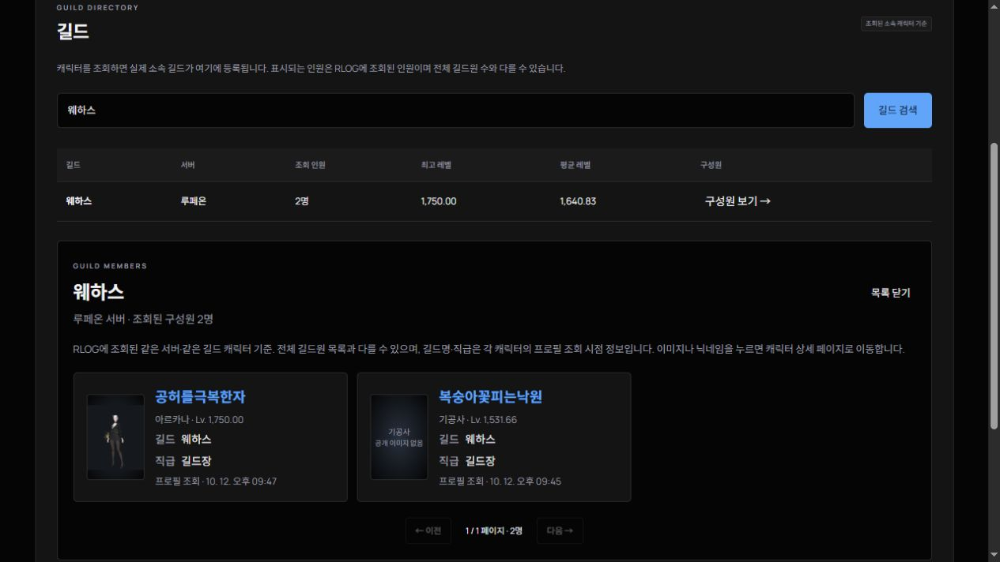

# RLOG — 로스트아크 캐릭터 검색

검정 다크 모드와 파란 포인트를 사용하는 로스트아크 캐릭터 검색 사이트입니다. 공식 API 서버, 공개 소식 수집, D1 집계 저장소를 포함합니다.

2026년 10월 13일 기준 원본 소스 보관본입니다. 현재 운영 주소: https://statpeek-ark.arcanagaming2026.chatgpt.site/

지금까지 구현한 화면과 기능은 [작업 내역](docs/진행-내용.md)에서 확인할 수 있습니다. 원본 파일 ZIP은 저장소 Releases에서 내려받을 수 있습니다.



## 기능과 데이터 범위

- 캐릭터 검색·최대 4명 비교·프로필·원정대: 공식 API
- 캐릭터 상세: 장비 16슬롯과 아바타, 보석/연결 스킬, 아크 패시브 및 기존 각인, 장착 카드와 활성 세트 효과, 수집형 포인트와 상세 현황. 공식 아이콘과 정제한 툴팁 표시. 캐릭터 이미지·기본 정보·순위·수집 요약을 왼쪽에, 방어구/장신구 옵션·전투 능력치를 오른쪽에 배치. 품질/상급 재련/아크 패시브 포인트를 표시하고 보석은 연결 스킬 이미지와 피해/쿨감으로 구분. 각인/카드, 아크 그리드 코어와 아크 패시브까지 공식 데이터로 제공하며 아이템 클릭 시 상세 팝업. 등급색은 공식 툴팁의 이름 색상 우선 적용
- 직업 순위: RLOG에 조회된 같은 직업 캐릭터 기준, 아이템 레벨/전투력 및 같은 서버 순위. 동점 공동 순위이며 게임 전체 순위가 아님
- 아크 패시브 각인은 효과 API에 이미지가 없으므로 해당 각인서의 공식 거래소 아이콘을 사용하고 출처를 표시
- 거래소 시세: 공식 API 분류·최저가·최근 거래가·전일 평균가·페이지 이동
- 주간 일정: 모험 섬·카오스게이트·필드보스(세베크 아툰 우선 표시)의 위치·입장 레벨·시간·보상
- 공지와 진행 중 이벤트: 공식 API 우선, 실패하면 공식 홈페이지 목록 수집. 출처와 확인 시각 표시
- 랭킹·순위·클래스/서버 통계·길드·명예의 전당: RLOG에서 조회해 저장한 실제 캐릭터 기준. 전체 게임 순위나 전체 길드원 수가 아님. 랭킹은 선택한 서버·정렬 기준 상위 100명
- 즐겨찾기·최근 검색·주간 체크리스트·테마: 브라우저 저장
- 건의/제보: Sites 로그인 후 서버 저장, 본인 접수 내역 조회
- 광고: 상단·사이드·하단 배너 또는 AdSense 설정 영역

가상 캐릭터 데이터는 사용하지 않습니다. 키가 없거나 인증이 실패하면 캐릭터·시세·일정에는 오류 상태를 표시합니다. 공지와 이벤트는 공개 홈페이지를 통해 계속 제공할 수 있습니다.

## 실행 및 빌드

Node.js 22.13 이상과 npm이 필요합니다. Sites의 Vinext/Cloudflare Worker 스타터를 사용합니다.

```powershell
npm run install:ci
npm run dev -- --port 4173 --hostname 127.0.0.1
npm run build
```

DB 초기화에는 체크인된 drizzle/*.sql 마이그레이션을 사용합니다. Sites 배포 시 D1 바인딩 DB 및 마이그레이션이 적용됩니다. 로컬 DB는 Wrangler의 로컬 D1에 별도로 적용해야 합니다.

```powershell
node --import ./scripts/sites-env.mjs ./node_modules/wrangler/bin/wrangler.js d1 execute DB --local --config dist/server/wrangler.json --persist-to .wrangler/state --file drizzle/0000_outstanding_roughhouse.sql
```

로컬 로그인은 스타터의 mock 로그인입니다. 실제 배포에서는 Sites 인증을 사용합니다. 로컬 테스트 DB와 브라우저 저장소는 운영 배포에 포함되지 않습니다.

## 공식 API 키

발급 포털: https://developer-lostark.game.onstove.com/

Sites 서버의 비밀 환경 변수 LOSTARK_API_KEY에 MY CLIENTS의 API KEY 원문을 설정합니다. 클라이언트 URL은 운영 사이트 루트 URL을 사용합니다. 키를 public/, HTML, 저장소, 광고 설정에 넣지 않습니다. /api/status에서 연결 여부를 확인할 수 있습니다. 비밀 값을 응답이나 로그로 출력하지 않습니다.

운영 사이트는 서버 비밀 환경 변수로 공식 API에 연결합니다. 각자 발급받은 API 키를 서버에 설정해야 하며, 이 저장소에는 실제 API 키가 포함되어 있지 않습니다. 거래소 분류는 공식 API의 CodeName과 유효한 분류 코드를 사용합니다.

공식 API 호출은 서버 메모리 캐시와 중복 요청 병합을 사용하며 요청 제한과 인증/네트워크 오류를 처리합니다. 캐시는 Worker 인스턴스별로 유지됩니다.

## 광고 연결

public/config.js의 RLOG_CONFIG를 편집합니다. 미설정 상태에서는 광고 스크립트를 로드하지 않습니다.

직접 배너는 public/assets/ 등에 이미지를 넣고 banners.top/sidebar/bottom에 image, href, alt를 설정합니다. AdSense는 adsense.client에 발급된 ca-pub-번호, adsense.slots에 광고 단위 번호를 설정합니다. 직접 배너가 같은 위치의 AdSense보다 우선합니다. 실제 게재에는 광고 계정과 사이트 승인이 필요합니다.

## 주요 파일

- lib/rlog.html: 페이지와 메뉴
- public/style.css: 검정/파란 디자인과 반응형 레이아웃
- public/live.js: 검색·표시·브라우저 저장·폼 처리
- lib/api.ts: API 인증·공식 소식·집계·제보 서버
- lib/parsers.ts: 공식 홈페이지 파싱과 URL 검증
- db/schema.ts, drizzle/: 저장소 스키마와 마이그레이션
- .openai/hosting.json: 기존 Sites 프로젝트와 D1 바인딩

외부 리소스: Google Fonts, 로스트아크 공식 이미지와 링크. 광고 설정 시 AdSense 스크립트가 추가됩니다.

캐릭터 검색은 /character?name=... 전용 페이지로 이동합니다. 다중 검색은 /compare?names=... 페이지로 이동하며, 두 화면 모두 홈 대시보드가 표시되지 않습니다. 직접 URL 열기·새로고침·브라우저 뒤로가기를 지원합니다. 캐릭터 이름을 누르는 상세 조회도 같은 캐릭터 페이지를 사용합니다.

캐릭터 상세의 길드·아바타·보유 캐릭터·주간 골드·원정대 골드 메뉴는 상단 캐릭터 이름과 메뉴를 유지하면서 각각 독립된 화면으로 전환합니다. 해당 화면에는 장비 및 왼쪽 요약 패널을 표시하지 않습니다. 장비·보석·각인·카드·아크 그리드·아크 패시브·수집·직업 순위는 기존 정보 화면에서 볼 수 있습니다. URL 해시로 직접 진입·새로고침·뒤로가기를 지원하며 메뉴를 전환해도 선택한 골드 계산 상태는 유지합니다.


## 원정대 이미지와 골드 계산

캐릭터 상세의 길드 메뉴는 공식 프로필의 길드명·서버·직위를 표시합니다. /api/character-guild는 같은 서버와 길드에 속하는 RLOG 조회 캐릭터만 모아 최대 100명을 보여주며, 전체 길드원 목록이나 길드 레벨·랭킹으로 표시하지 않습니다. 공식 /guilds/rankings API는 제거되어 사용하지 않습니다. 미가입 캐릭터는 길드 미가입 상태로 표시합니다. 장비 아이콘 배경은 공식 전투정보실의 등급별 그라데이션을 적용합니다.

길드 검색 결과의 길드명 또는 구성원 보기 버튼은 해당 서버·길드의 조회 기록을 /api/guild-members에서 페이지당 12명씩 표시합니다. 캐릭터 이미지·닉네임·길드명·직급과 프로필 조회 시점을 보여주고, 카드를 누르면 기존 /character?name=... 상세 화면으로 이동합니다. 이미지가 없는 기록은 기존 portrait API와 2개 동시 요청 제한으로 보완하며 직급이 없으면 미공개로 표시합니다. 구성원 목록은 전체 길드원 명단이 아닌 RLOG의 조회 기록입니다.

보유 캐릭터는 공식 siblings API로 목록을 가져오고, 이미지가 없는 목록 항목은 /api/portrait에서 공식 profiles API로 보완합니다. 프로필 이미지는 서버에서 10분 캐시하고 브라우저는 최대 2개씩 요청합니다. API 키는 서버 비밀값만 사용합니다. 수집형 포인트는 해당 종류의 공식 API 이미지를 전용 프레임에서 원본 비율로 표시합니다.

public/raid-rewards.json은 2026-10-12에 공식 입장 가이드·업데이트 및 커뮤니티 보상표를 대조한 레이드 보상 데이터입니다. public/gold.js가 입장 레벨, 캐릭터당 3종, 같은 서버 원정대당 6명, 동일 레이드 난이도 중복 방지를 적용합니다. 노말 추천 또는 입장 가능한 최대 총액 추천을 제공하며 레이드·난이도·골드 획득 캐릭터를 수정할 수 있습니다. 거래 가능/귀속 골드를 따로 계산합니다. 클리어 여부와 게임 내 골드 획득 캐릭터 지정은 API로 알 수 없어 예상액으로 표시합니다. 카멘 4관문(격주), 더보기·경매·이벤트·미검증 싱글/매칭 보상은 제외합니다. 1600 미만 콘텐츠는 현 보상표에 포함되지 않습니다. 새로운 보상 변경 시 JSON을 갱신해야 하며 실시간 보상 조회라고 표시하지 않습니다.
