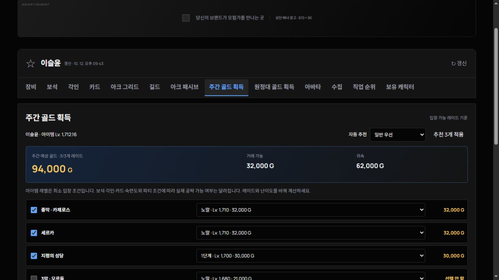

# RLOG 작업 내역

2026년 10월 13일에 지금까지 구현한 사이트의 원본 소스를 GitHub에 보관했습니다.

## 디자인과 탐색

- 사이트 이름을 RLOG로 통일하고 검정 다크 모드, 파란 강조색, 라이트 모드를 적용했습니다.
- 큰 소개 배너를 제거하고 상단의 작은 캐릭터 검색창과 메뉴를 사용합니다.
- 캐릭터 검색은 전용 상세 페이지로 이동하며 홈 화면과 분리됩니다.
- 장비·보석·각인·카드·아크 그리드·아크 패시브를 함께 볼 수 있는 정보 화면을 구성했습니다.
- 길드·아바타·보유 캐릭터·주간 골드·원정대 골드는 상단 이름과 메뉴를 유지하는 독립 화면으로 전환됩니다.
- 글자와 이미지를 확대하고 장비 아이콘에 등급별 공식 배경색을 적용했습니다.

## 캐릭터와 원정대

공식 API에서 캐릭터 프로필, 장착 장비와 품질·재련·효과, 보석과 연결 스킬, 각인, 카드와 각성·세트 효과, 아바타, 아크 그리드, 아크 패시브, 수집형 포인트와 상세 현황을 가져옵니다. 아이템을 클릭하면 상세 효과를 확인할 수 있습니다.

보유 캐릭터에는 닉네임과 실제 캐릭터 이미지를 표시하고 상세 검색 페이지로 연결합니다. 수집형 포인트는 공식 종류별 아이콘과 수집 수치를 사용합니다.

## 길드 검색과 구성원

길드 이름으로 검색하고 길드명 또는 구성원 보기 버튼을 누르면 서버별 구성원 기록을 확인할 수 있습니다. 닉네임·길드명·이미지·직급·프로필 조회 시점을 표시하며 이미지나 이름을 클릭하면 기존 캐릭터 상세 페이지로 이동합니다. 구성원은 페이지당 12명씩 표시합니다.

공식 API에서 전체 길드원 명단을 제공하지 않으므로 구성원은 RLOG에 조회된 기록 기준입니다. 직급이나 이미지가 공개되지 않은 경우 해당 상태를 표시합니다. 다른 서버의 동명 길드는 별도로 집계합니다.

## 골드 계산

캐릭터 아이템 레벨로 입장 가능한 레이드의 예상 주간 골드를 계산합니다. 캐릭터당 최대 3종, 같은 서버 원정대당 최대 6명을 적용합니다. 추천 방식·레이드·난이도를 바꿀 수 있고 거래 가능 골드와 귀속 골드를 구분합니다. 화면을 전환해도 선택한 계산 상태는 유지됩니다.

보상 데이터의 확인 기준일은 2026년 10월 12일입니다. 실제 클리어 여부와 게임 내 골드 획득 캐릭터 지정은 API로 확인할 수 없어 예상액으로 표시합니다. 보상이 변경되면 public/raid-rewards.json을 갱신해야 합니다.

## 홈과 부가 기능

- 로스트아크 공식 공지와 진행 중인 이벤트
- 모험 섬·카오스게이트·필드보스 주간 일정
- 거래소 시세와 검색·페이지 이동
- 조회 기록 기반 랭킹·직업 순위·클래스/서버 통계·명예의 전당
- 즐겨찾기·최근 검색·주간 체크리스트
- 로그인 후 건의/제보 등록과 본인 접수 내역
- 상단·사이드·하단 배너 및 AdSense 설정 영역

## 기술 구성과 검증

원본에는 HTML/CSS/JavaScript 화면 코드, TypeScript API 서버, Vinext/Cloudflare Worker 빌드 설정, D1 스키마와 SQL 마이그레이션, 의존성 잠금 파일, 골드 계산 검증 스크립트를 포함합니다.

기존 작업에서 공식 API 인증과 실제 캐릭터 데이터, 장비·카드·각인 처리, 검색 화면 이동, 서버별 길드 구성원 구분과 페이지 처리, 골드 계산 제한·합계, 메뉴 전환·새로고침·뒤로가기를 검사하고 빌드·배포했습니다.

API 키, 사용자 txt 원문, 로컬 데이터베이스, node_modules, 빌드 출력과 도구 실행 상태는 업로드하지 않습니다. 게임 이미지의 권리는 해당 권리자에게 있으며 운영 화면에서는 공식 이미지 주소를 사용합니다.

원본 사이트 소스 기준 커밋: bd5c27a324526a6918a6cde3d6efcf12d9b029f9
